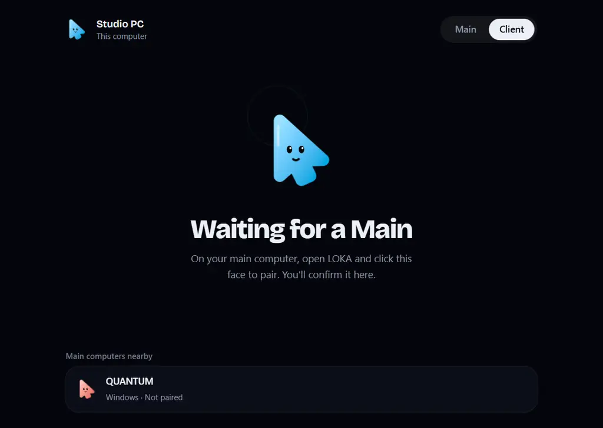

<div align="center">


# LOKA

**Satu mouse dan keyboard untuk semua komputer di mejamu.**
Dorong kursor melewati tepi layar yang menyala, dan kursor langsung pindah ke perangkat di sebelahnya.

[English](README.md) · **Bahasa Indonesia** · [Website](https://aufanirsad.me/LOKA) · [Unduh](https://github.com/fanrsd/LOKA/releases/latest)


</div>

## Fitur

- **Berbagi mouse dan keyboard.** Satu komputer menjadi **Main**: mouse dan keyboard-nya mengendalikan perangkat lain. Setiap perangkat di sekitarnya menjalankan LOKA sebagai **Client**.
- **Bezel Portal.** Tandai bagian tepi layar tempat perangkat lain berada di mejamu. Dorong kursor ke garis yang menyala itu, dan kursor pindah ke sana. Dorong keluar dari sisi seberang perangkat itu untuk kembali. **Ctrl+Alt+Esc** selalu mengembalikannya.
- **Keyboard ikut kursor.** Ketikan selalu masuk ke perangkat tempat kursor berada.
- **Lempar file ke tepi layar.** Seret file ke garis yang menyala lalu lepaskan. File masuk ke `Downloads/LOKA` di perangkat pasangan. File lama tidak pernah ditimpa.
- **Pairing ala LocalSend.** Perangkat di jaringan yang sama saling menemukan. Klik salah satunya, lalu konfirmasi di perangkat itu.
- **Sesuaikan sendiri.** Pilih warna glow (sekaligus jadi warna aksen aplikasi) dan animasi saat menyeberang: Ripple, Pulse, atau Calm.

Kenalan dengan **Tuju**, maskot LOKA: sebuah kursor, benda yang memang berpindah antar layar. Setiap perangkat punya warna Tuju sendiri, dan wajahnya menunjukkan status: mencari, menunggu, terhubung, atau offline.

| | |
|---|---|
|  |  |
|  |  |

## Platform

| Platform | Status |
|---|---|
| Windows 10/11 | Berjalan (Main dan Client) |
| macOS | Kode lengkap, masih diuji di perangkat asli. Perlu izin **Accessibility**. |
| Android | Direncanakan |
| iOS | Tidak direncanakan: iOS tidak mengizinkan aplikasi mengendalikan input perangkat |

## Instalasi

Unduh installer dari [Releases](https://github.com/fanrsd/LOKA/releases/latest):

- **Windows:** `LOKA_x.y.z_x64-setup.exe` atau `.msi`
- **macOS:** `LOKA_x.y.z_universal.dmg`. Aplikasi belum dinotarisasi, jadi saat pertama kali klik kanan lalu pilih **Open**.

Lalu:

1. Buka LOKA di kedua komputer dan pilih peran: **Main** untuk komputer yang punya mouse dan keyboard, **Client** untuk yang lain.
2. Di Main, klik Tuju milik Client. Terima di Client.
3. Pilih tepi layar, lalu geser bar yang menyala sampai sejajar dengan letak perangkat lain.

Kedua perangkat harus berada di jaringan lokal yang sama. LOKA memakai UDP 53318 (pencarian perangkat) dan TCP 53319–53321 (telemetri, file, input). Izinkan port tersebut di firewall.

## Build dari source

Kebutuhan: [Node.js](https://nodejs.org) 20+, [Rust](https://rustup.rs) (stable), dan [prasyarat Tauri](https://tauri.app/start/prerequisites/) untuk OS-mu.

```bash
npm install
npm run tauri dev        # jalankan
npm run sim              # jalankan dengan simulasi Client di ponsel
npm run tauri build      # installer ada di src-tauri/target/release/bundle
```

## Keamanan

LOKA dibuat untuk jaringan rumah atau kantor yang tepercaya. Hanya perangkat yang sudah di-pairing yang bisa mengirim input atau file, tetapi lalu lintasnya belum dienkripsi. Hindari Wi-Fi publik.

## Lisensi

[Apache License 2.0](LICENSE). Fork dan versi yang diubah wajib menyertakan file [NOTICE](NOTICE) dan mencantumkan proyek aslinya:

> Based on LOKA by Aufa Nirsad: https://github.com/fanrsd/LOKA
