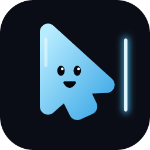
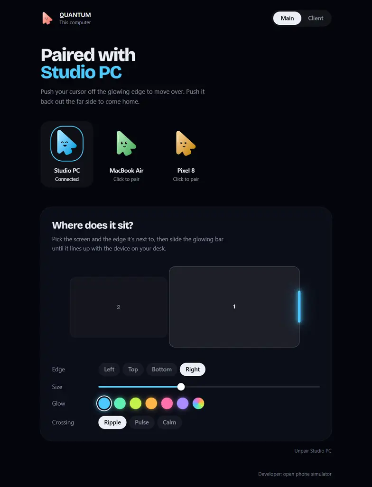
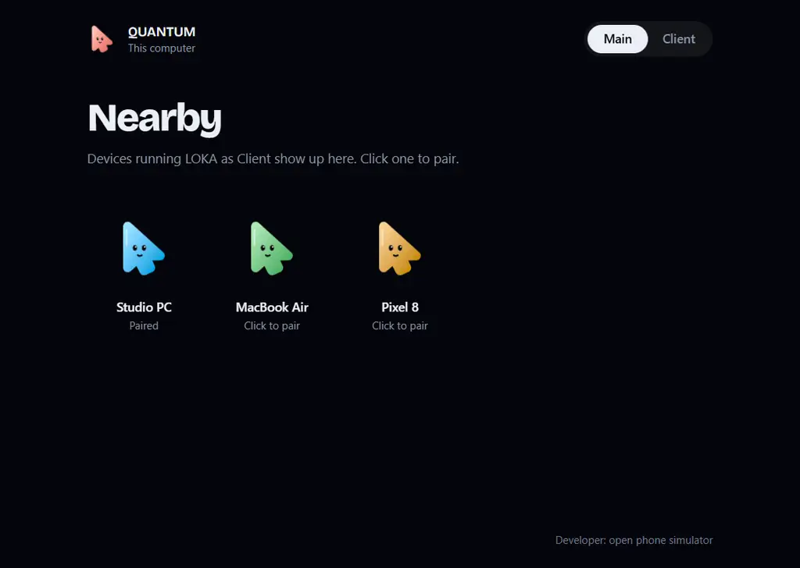
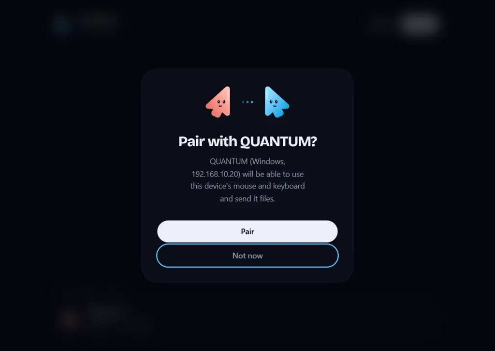
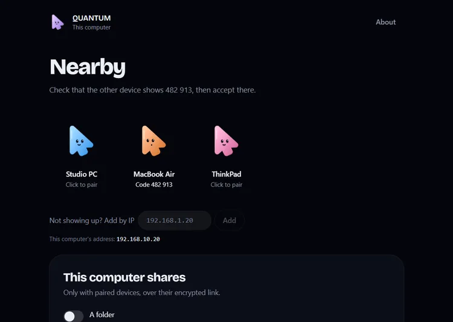
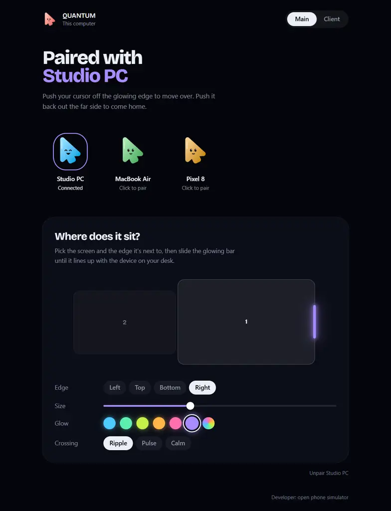

<div align="center">



# LOKA

**Satu mouse dan keyboard untuk semua komputer di mejamu.**
Dorong kursor melewati tepi layar yang menyala, dan kursor langsung pindah ke perangkat di sebelahnya.

[English](README.md) · **Bahasa Indonesia** · [Website](https://loka.margingroup.id) · [Unduh](https://github.com/fanrsd/LOKA/releases/latest)



</div>

## Fitur

- **Berbagi mouse dan keyboard, ke arah mana pun.** Setiap komputer yang menjalankan LOKA bisa mengendalikan yang lain dan dikendalikan olehnya: dorong kursor dari komputer mana pun yang sedang kamu pegang.
- **Bezel Portal.** Tandai bagian tepi layar tempat perangkat lain berada di mejamu. Dorong kursor ke garis yang menyala itu, dan kursor pindah ke sana. Dorong keluar dari sisi seberang perangkat itu untuk kembali. **Ctrl+Alt+Esc** atau tekan **Ctrl** dua kali selalu mengembalikannya. Taruh beberapa perangkat di tepi berbeda, dan kursor bisa terus lanjut dari satu ke berikutnya (PC → Mac → laptop).
- **Terasa seperti satu komputer.** Kursor menghilang dari layar komputer yang sedang mengendalikan. Ctrl berfungsi sebagai ⌘ di Mac (dan ⌘ sebagai Ctrl di PC), jadi shortcut tetap jalan. Atur kecepatan pointer di seberang dan jeda tepi opsional supaya kursor tidak menyeberang saat lewat sekilas. **Scroll Lock** (F14 di Mac) mengunci pointer di layar tempat dia berada. Swipe trackpad Mac antar-desktop, Mission Control, dan pinch-to-zoom juga jalan di komputer lain.
- **Keyboard dan clipboard ikut kursor.** Ketikan selalu masuk ke perangkat tempat kursor berada. Salin di satu komputer, pindah, lalu tempel di komputer lain, dua arah: teks, gambar (termasuk screenshot, sampai 10 MB), dan file yang kamu salin di Explorer atau Finder. Isi yang ditandai rahasia oleh password manager tidak ikut dikirim. **Recent clipboard** menyimpan 12 hal terakhir yang kamu salin, gambar juga: klik untuk menyalinnya lagi.
- **Seret file menyeberang.** Ambil file di Explorer atau Finder lalu terus seret melewati tepi yang menyala: kursor membawanya ke seberang, dan kamu bisa melepasnya di folder atau aplikasi mana pun di komputer lain. File besar mengalir: drop langsung dimulai dan terisi seiring file tiba.
- **Lempar file ke tepi layar, dua arah.** Seret file atau folder ke garis yang menyala lalu lepaskan. Semuanya masuk ke `Downloads/LOKA` (atau folder pilihanmu) di perangkat pasangan, folder lengkap dengan isinya, beberapa file sekaligus. Saat kamu sedang mengendalikan komputer lain, tepinya yang mengarah balik juga menyala: seret file ke sana untuk mengirim ke arah sebaliknya. File lama tidak pernah ditimpa.
 Garis yang menyala terisi seiring file berjalan, dan kedua komputer menampilkan progres, kecepatan, serta sisa waktunya. Transfer bisa dibatalkan, foldernya bisa langsung dibuka saat file tiba, dan ada notifikasi sistem ketika file masuk. **Ctrl+Alt+V** menempel file yang baru tiba ke aplikasi di depan (chat, email). Bisa juga kirim dari **Send to → LOKA** di Explorer atau **Open With → LOKA** di Finder.
- **Pairing ala LocalSend.** Perangkat di jaringan yang sama saling menemukan. Klik salah satunya, lalu konfirmasi di perangkat itu. Di jaringan yang memblokir pencarian perangkat (Wi-Fi tamu), tambahkan komputer lain lewat alamat IP-nya. Saat pairing, kedua layar menampilkan kode 6 digit yang sama, jadi kamu tahu perangkatnya benar, dan tidak ada orang di jaringan yang bisa memalsukannya.
- **Update sendiri.** Saat ada versi baru, Oka muncul dengan isi pembaruannya; sekali klik LOKA mengunduh, memasang, lalu membuka ulang dirinya (Windows, macOS, Linux). Menu **About** menampilkan versi dan riwayat perubahan.
- **Sesuaikan sendiri.** Pilih warna glow (sekaligus jadi warna aksen aplikasi), seberapa transparan dan setebal apa glow-nya, apakah selalu tampil atau hanya saat kursor mendekat, dan animasi saat menyeberang: Ripple, Pulse, atau Calm. Setiap klik di LOKA berbunyi "tik" pelan; ikon speaker di pojok kanan atas mematikannya.
- **HP Android juga.** Dorong kursor komputer ke tepi tempat HP berada dan kursor pindah ke HP: tap, scroll, dan mengetik di sana dengan mouse dan keyboard komputer (tombol kanan = Back, tengah = Home). Atau pakai HP sebagai touchpad dan keyboard untuk komputer, dan kirim file dari HP. LOKA menyiapkannya dari HP sendiri lewat Wireless debugging (Android 11+), tanpa kabel atau aplikasi di PC.
- **Berbagi lebih, hanya kalau kamu mau.** Setiap komputer bisa berbagi folder (terbuka sebagai drive di komputer lain), suaranya (diputar lewat speaker komputer lain), notifikasinya (Windows), mikrofonnya (dipakai sebagai mic untuk call di komputer lain, lewat VB-CABLE atau BlackHole yang gratis), dan terminal. Semuanya mati sampai kamu nyalakan.
- **Koneksi yang tahu diri.** Kalau komputer lain tidur, lepas dari Wi-Fi, atau macet, kursor pulang dalam sekitar 3 detik dan tidak ada tombol yang tertahan di sana. Pindah Wi-Fi di tengah sesi tetap jalan.
- **Bangunkan dari jauh.** Komputer pasangan yang sedang tidur punya tombol **Wake up** (Wake-on-LAN).
- **Tinggal di tray.** Menutup jendela tidak menghentikan LOKA. Menu tray bisa **Control** perangkat mana pun tanpa menyentuh tepi, **Disconnect**, membuka LOKA lagi, atau **Quit LOKA**.

Kenalan dengan **Oka**, si kecil dari LOKA: sebuah kursor, benda yang memang berpindah antar layar. Setiap perangkat punya warna Oka sendiri, dan wajahnya menunjukkan status: mencari, menunggu, terhubung, atau offline.

| | |
|---|---|
|  |  |
|  |  |

## Keamanan

- **Selalu terenkripsi.** Setiap koneksi antar perangkat (input, clipboard, file, layanan) memakai QUIC dengan **TLS 1.3**, dengan sertifikat di kedua sisi.
- **Terikat ke perangkat, bukan alamat.** Setiap LOKA punya sertifikat sendiri; **fingerprint** SHA-256-nya adalah identitasnya. Perangkat pasangan diingat lewat fingerprint itu, jadi komputer yang sekadar memakai alamat IP-nya tidak bisa masuk, dan perangkat yang belum di-pairing ditolak.
- **Kode pairing yang tidak bisa dipalsukan.** Kedua layar menampilkan kode 6 digit yang sama, dihitung dari kedua fingerprint dan angka acak dari tiap sisi. Peminta mengunci angkanya sebelum melihat angka lawan, jadi penyusup di tengah tidak bisa mencoba-coba sertifikat sampai kodenya kebetulan cocok.
- **Tidak ada yang keluar dari jaringanmu.** Tanpa akun, server, atau cloud. Berbagi folder, suara, notifikasi, mic, atau terminal mati sampai kamu nyalakan.

## Platform

| Platform | Status |
|---|---|
| Windows 10/11 | Berjalan |
| macOS | Kode lengkap, masih diuji di perangkat asli. Perlu izin **Accessibility**. |
| Linux | Baru: desktop X11 dan Wayland, serta server tanpa desktop (`loka --headless`). Masih diuji di perangkat asli. |
| Android 11+ | Baru: dikendalikan dari komputer (sekali setup lewat Wireless debugging), HP sebagai touchpad dan keyboard, kirim file. Masih diuji di HP asli. |
| iOS | Tidak direncanakan: iOS tidak mengizinkan aplikasi mengendalikan input perangkat |

## Instalasi

Unduh installer dari [Releases](https://github.com/fanrsd/LOKA/releases/latest):

- **Windows:** `LOKA_x.y.z_x64-setup.exe` atau `.msi`. Jika SmartScreen memperingatkan, pilih **More info → Run anyway**. Saat Windows Firewall bertanya, centang **Private** dan **Public**. Perangkat masih tidak saling terlihat? Di LOKA buka **About → Allow through Windows Firewall**.
- **macOS:** `LOKA_x.y.z_universal.dmg` (Apple Silicon dan Intel). Buka, seret LOKA ke **Applications**, lalu buka dari folder Applications. LOKA belum dinotarisasi, jadi pembukaan pertama diblokir: klik **Done** (jangan Move to Trash), lalu:
  - macOS 15 ke atas: System Settings → Privacy & Security → gulir ke bawah → **Open Anyway**.
  - macOS 14 ke bawah: klik kanan LOKA di Applications → **Open** → **Open**.
  - "LOKA is damaged and can't be opened" (atau versi apa pun): jalankan di Terminal

    ```bash
    xattr -dr com.apple.quarantine /Applications/LOKA.app
    ```

  Izinkan **Accessibility** saat diminta (System Settings → Privacy & Security → Accessibility), di setiap Mac; di macOS 15+ izinkan juga **Local Network**. Setelah update, jika mouse tidak bisa pindah lagi, hapus LOKA dari daftar Accessibility dengan tombol **−** lalu aktifkan lagi.
- **Linux:** `LOKA_x.y.z_amd64.deb` (Debian, Ubuntu), `.rpm` (Fedora), atau `.AppImage`. LOKA membaca mouse dan keyboard di bawah desktop, jadi perlu izin sekali: **About → Allow input access** (minta password).
- **Server Linux tanpa desktop:** pasang `.deb` atau `.rpm`, lalu jalankan `sudo loka --headless` di server (atau `sudo loka --allow-input` sekali, lalu `loka --headless` sebagai user biasa). Pair dari LOKA di komputer lain dan jawab kodenya di terminal. Ketikan keyboard masuk ke console server.
- **Android:** `LOKA_x.y.z_android.apk` di HP (izinkan pemasangan dari browser atau Files saat diminta). Buka LOKA, pair dengan komputer, lalu ketuk **Set up** supaya komputer bisa masuk ke HP: LOKA memandu Developer options → Wireless debugging → kode pairing, yang diketik langsung di notifikasi LOKA. Xiaomi/POCO juga perlu **USB debugging (Security settings)**.

Lalu:

1. Buka LOKA di kedua komputer.
2. Di salah satunya, seret Oka komputer lain ke tepi layar yang bersebelahan dengannya di mejamu (atau klik). Pastikan kedua layar menampilkan kode yang sama, lalu terima di komputer lain.
3. Geser kotaknya di sepanjang tepi sampai cahayanya sejajar dengan letak perangkat lain. Komputer lain otomatis menaruh komputer ini di tepi yang berseberangan.

Kedua perangkat harus berada di jaringan lokal yang sama. LOKA memakai UDP 53318 (pencarian perangkat) dan TCP 53319–53321 (telemetri, file, input). Wi-Fi tamu atau router dengan client isolation memblokir pencarian: LOKA menampilkan **This computer's address** di bawah **Add by IP**; ketik alamat itu di **Add by IP** pada komputer lain.

## Build dari source

Kebutuhan: [Node.js](https://nodejs.org) 20+, [Rust](https://rustup.rs) (stable), dan [prasyarat Tauri](https://tauri.app/start/prerequisites/) untuk OS-mu.

```bash
npm install
npm run tauri dev        # jalankan
npm run sim              # jalankan dengan simulasi ponsel
npm run tauri build      # installer ada di src-tauri/target/release/bundle
```

## Lisensi

[Apache License 2.0](LICENSE). Fork dan versi yang diubah wajib menyertakan file [NOTICE](NOTICE) dan mencantumkan proyek aslinya:

> Based on LOKA by Aufa Nirsad: https://github.com/fanrsd/LOKA
